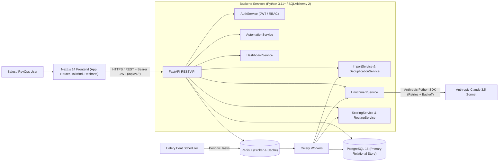
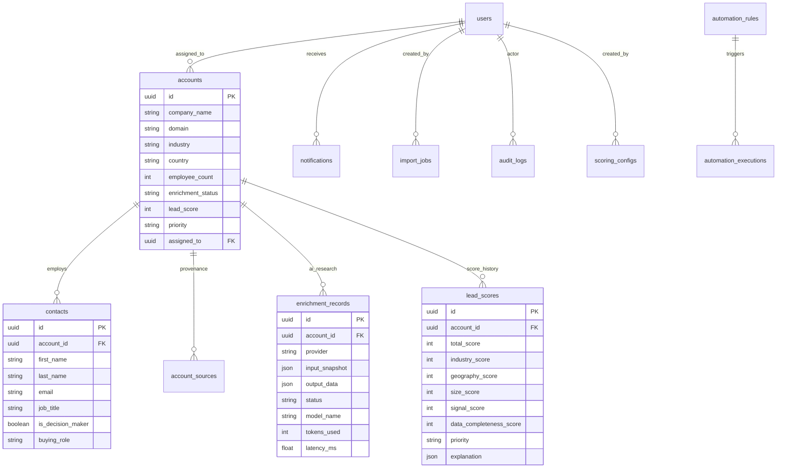

# GTMFlow – System Architecture & Engineering Design

> Technical architecture reference for the **GTMFlow** platform: AI-Powered Lead Intelligence, Account Scoring & Sales Automation.

---

## 1. Architectural Principles

GTMFlow is structured as a **modular monolithic backend** (FastAPI + SQLAlchemy 2 + Celery) paired with a **strongly typed Next.js 14 App Router frontend**. Rather than prematurely splitting into microservices, core GTM domain logic lives in reusable Python service modules (`app/services/*`) shared cleanly by both synchronous HTTP REST endpoints (`app/api/v1/endpoints/*`) and asynchronous Celery background workers (`app/workers/*`).

Key architectural invariants:
1. **PostgreSQL as Single Source of Truth**: All accounts, contacts, provenance records, scoring breakdowns, automation executions, and audit diffs live in PostgreSQL. Celery tasks never depend on frontend state.
2. **Evidence-Grounded AI Enrichment**: Claude 3.5 Sonnet receives only verified database evidence (`company_name`, `domain`, `industry`, `country`, `employee_count`, `description`, provenance sources, and known contact titles), enforcing strict JSON schema validation via Pydantic v2. Unverified claims require human approval on the AI Enrichment Review queue.
3. **Deterministic + Explainable Lead Scoring**: Scoring is computed deterministically via weighted rules (`ScoringConfig`) across 5 dimensions (100 points total), generating structured per-factor explanations rather than opaque black-box numbers.
4. **Graceful Async + Sync Fallback**: Endpoints such as `/imports/start` and `/accounts/bulk-enrich` probe Redis broker reachability and dispatch to Celery workers when healthy, seamlessly falling back to synchronous execution in single-process test or offline environments.

---

## 2. System Component Diagram

---

## 3. PostgreSQL Entity-Relationship Model

Managed via Alembic migrations (`backend/alembic/versions/`):

Additional operational tables:
- `import_jobs`: Chunked CSV/XLSX ingestion job status, field mappings, duplicate/failure tallies, and row-level error summaries.
- `job_executions`: Unified telemetry for background batch jobs (`ENRICH`, `SCORE`, `ROUTING`, `IMPORT`), retry counters, and manual retry recovery (`POST /jobs/{id}/retry`).
- `audit_logs`: Immutable compliance trail recording `CREATE`, `UPDATE`, `DELETE`, `IMPORT`, `ENRICH`, `SCORE`, `ASSIGN`, and config changes with old/new JSON diffs.

---

## 4. Core Data Pipelines

### 4.1 Multi-Stage Data Ingestion & Deduplication
1. **Upload & Preview (`POST /api/v1/imports/upload`)**: Parses CSV/Excel headers using Pandas and auto-suggests target fields (`company_name`, `domain`, `email`, `first_name`, `last_name`, `country`, `industry`, `employee_count`, `job_title`).
2. **Normalization**: Strips corporate suffixes (`GmbH`, `SAS`, `NV`, `Inc`, `Ltd`, `AG`, `AB`), canonicalizes domains from URLs/emails, validates emails, and coerces headcount integers.
3. **3-Tier Account Deduplication (`DeduplicationService`)**:
   - Stage 1: Exact normalized `domain` match
   - Stage 2: Exact normalized `(company_name, country)` match
   - Stage 3: Global fuzzy/normalized `company_name` match when domain is absent
4. **Conflict Resolution Policies**: `PRESERVE_EXISTING`, `OVERWRITE_EMPTY`, or `UPDATE_ALL`, tracking provenance in `account_sources`.

### 4.2 Claude AI Enrichment & Offline Evidence Mode (`ClaudeClient` + `EnrichmentService`)
- Constructs a grounded `input_snapshot` from PostgreSQL records.
- Invokes Anthropic Messages API (`claude-3-5-sonnet-20241022`) with exponential backoff retries (`RateLimitError`, `APIConnectionError`, `APITimeoutError`, `InternalServerError`).
- Strips markdown fences, parses strict JSON into `ClaudeEnrichmentPayload` (summary, normalized industry, target market fit `high|medium|low`, ISO 27001/SOC 2/GDPR compliance relevance, buying signals with source evidence, target decision-maker roles, confidence score, and next action).
- When `ANTHROPIC_API_KEY` is blank or unset (local demos/tests), transparently falls back to `HEURISTIC_FALLBACK` (`analysis_mode="offline_heuristic"`) built strictly from observed fields.
- Analysts approve or reject enrichment outputs (`POST /api/v1/enrichment/{id}/review`), optionally writing approved industry classifications or descriptions back to the `Account`.

### 4.3 Deterministic Lead Scoring & Least-Loaded Sales Routing
- **Lead Scoring (`ScoringService`)**: 100-point weighted breakdown across Industry (`30`), Geography (`20`), Company Size (`20`), Buying Signals (`20`), and Data Completeness (`10`), editable by `ADMIN` users via `/scoring`.
  - Priority thresholds: `HIGH` (>= 80), `MEDIUM` (50-79), `LOW` (< 50).
- **Least-Loaded Routing (`RoutingService`)**: Automatically assigns accounts to the active `SALES` representative with the fewest total assigned accounts (breaking ties by fewest `HIGH`-priority accounts, then earliest creation date), emitting an in-app `Notification` and `AuditLog`.

### 4.4 Automation Rules & Scheduled Celery Beat Workflows
- `AutomationService` evaluates declarative rules (`ON_ENRICHMENT_COMPLETE`, `ON_SCORE_CALCULATED`, `SCHEDULED_DAILY`, `MANUAL`) against account conditions (`min_score`, `priority`, `enrichment_status`, `country`, `unassigned_only`) and chains actions (`ENRICH_ACCOUNT`, `SCORE_ACCOUNT`, `AUTO_ASSIGN_REP`, `CREATE_ALERT`).
- `Celery Beat` (`app/workers/schedules.py`) runs periodic heartbeat, pending-account enrichment every 15 minutes, and hourly lead scoring sweeps.
